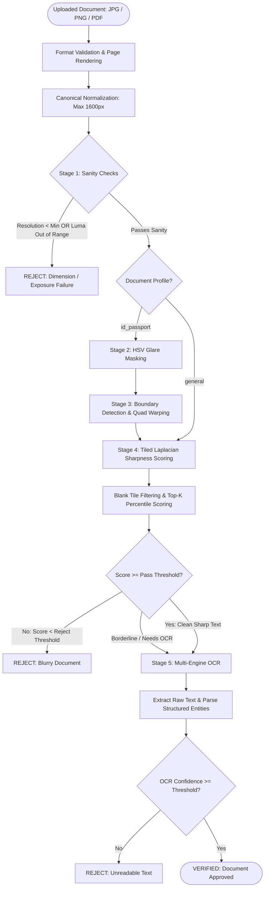

# 📄 DocVerify AI

> **Production-Grade Document Quality Verification, Blur Detection & Multi-Engine OCR Microservice**  
> Built with FastAPI, OpenCV, PyTorch, docTR, PaddleOCR, Tesseract, and React.

[](https://www.python.org/downloads/)
[](https://fastapi.tiangolo.com/)
[](https://react.dev/)
[](https://vitejs.dev/)
[](https://www.docker.com/)
[](https://opensource.org/licenses/MIT)

---

## 📑 Table of Contents

- [Overview](#-overview)
- [Key Features](#-key-features)
- [System Architecture](#-system-architecture)
- [Complete Processing Pipeline](#-complete-processing-pipeline)
  - [Pipeline Flowchart](#pipeline-flowchart)
  - [The Two Document Profiles](#the-two-document-profiles)
  - [Detailed Stage-by-Stage Breakdown](#detailed-stage-by-stage-breakdown)
- [Supported OCR Engines](#-supported-ocr-engines)
- [Integrating into External Projects](#-integrating-into-external-projects)
  - [Architecture Patterns](#architecture-patterns)
  - [1. Python Integration](#1-python-integration)
  - [2. Node.js / TypeScript Integration](#2-nodejs--typescript-integration)
  - [3. cURL / Shell Scripts](#3-curl--shell-scripts)
  - [4. Go / Java / C# Integration](#4-go--java--c-integration)
- [REST API Reference](#-rest-api-reference)
- [Interactive Admin Web UI](#-interactive-admin-web-ui)
- [Challenge Test Dataset](#-challenge-test-dataset)
- [Local Development & Deployment](#-local-development--deployment)
- [Configuration Reference](#-configuration-reference)

---

## 🎯 Overview

In banking, fintech, KYC/AML onboarding, healthcare, and document automation systems, **unreadable or blurry documents** lead to downstream OCR hallucination, manual review bottlenecks, and regulatory non-compliance.

**DocVerify AI** serves as an intelligent quality gatekeeper microservice. It analyzes uploaded document images or multi-page PDFs, identifies visual defects (blur, specular glare, poor resolution, skewed perspective, extreme brightness), scores document quality using robust computer vision mathematics, and extracts validated structured entities using state-of-the-art multi-engine OCR.

---

## ✨ Key Features

- **🚀 Two Specialized Verification Pipelines**:
  - `general`: Optimized for text-dense documents, invoices, receipts, and multi-page PDFs.
  - `id_passport`: Optimized for identity cards and passports with automated 4-corner boundary quad detection, perspective rectification, specular glare masking, and MRZ validation.
- **🔍 Tiled Laplacian Sharpness Scoring**:
  - Grid-based ($3 \times 3$) tile evaluation that eliminates the "blank margin false-rejection trap".
  - Discards low-texture/blank tiles and scores only top-$K\%$ informative content tiles.
- **🧭 Gradient Anisotropy Motion-Blur Detection**:
  - Distinguishes between clean horizontal text lines and severe directional camera shake or motion blur.
- **☀️ HSV Specular Glare Masking**:
  - Detects specular reflections from camera flashes or laminations and prevents glare spots from artificially inflating sharpness scores.
- **🧠 Multi-Engine OCR Architecture**:
  - Pick and choose between **docTR (Mindee PyTorch)**, **PaddleOCR (PP-OCRv4 ONNX)**, and **Tesseract OCR**.
  - Dynamic fallback: if a selected deep-learning engine is temporarily unavailable, it automatically falls back without crashing.
- **⚡ High-Throughput Bulk Processing**:
  - Multi-core parallel execution via `ProcessPoolExecutor` for batch document ingestion.
- **🖥️ Modern Glassmorphic React UI**:
  - Interactive file upload, real-time stage breakdowns, side-by-side visual inspection, and dynamic threshold tuning.

---

## 🏗️ System Architecture

```
┌────────────────────────────────────────────────────────────────────────────────────────┐
│                                 Client Applications                                    │
│   (Fintech Onboarding, KYC Microservice, Mobile Backend, Django, NestJS, Go, cURL)     │
└───────────────────────────────────────────┬────────────────────────────────────────────┘
                                            │ HTTP / REST (Multipart Form)
                                            ▼
┌────────────────────────────────────────────────────────────────────────────────────────┐
│                             DocVerify AI REST Microservice                             │
│                                 (FastAPI on Port 8000)                                 │
│                                                                                        │
│   Endpoints:                                                                           │
│   • POST /api/v1/verify          Full CV quality evaluation + OCR extraction           │
│   • POST /api/v1/ocr/extract     Standalone high-accuracy OCR extraction               │
│   • POST /api/v1/verify/bulk     Parallel multi-document batch verification            │
│   • GET  /api/v1/health          Liveness & multi-engine availability probe            │
│   • GET  /api/v1/config/defaults Dynamic pipeline threshold querying                   │
└───────────────────────┬────────────────────────────────────────┬───────────────────────┘
                        │                                        │
                        ▼                                        ▼
┌────────────────────────────────────────┐    ┌──────────────────────────────────────────┐
│        Computer Vision Pipeline        │    │          Multi-Engine OCR Pool           │
│                                        │    │                                          │
│ • Canonical Resizing & Preprocessing   │    │ • docTR (PyTorch Transformer OCR)        │
│ • Dimension & Luma Sanity Checks       │    │ • PaddleOCR (PP-OCRv4 ONNX Engine)       │
│ • HSV Specular Glare Masking           │    │ • Tesseract OCR (Fast Baseline)          │
│ • 4-Corner Quad Perspective Rectify    │    │ • Regex & Levenshtein Field Validator    │
│ • Tiled Laplacian Scoring              │    │   (MRZ, Document No, Full Name, Dates)   │
│ • Anisotropy Ratio Directional Blur    │    └──────────────────────────────────────────┘
└────────────────────────────────────────┘
```

---

## 🔄 Complete Processing Pipeline

### Pipeline Flowchart



---

### The Two Document Profiles

| Characteristic | `general` Pipeline | `id_passport` Pipeline |
|---|---|---|
| **Target Documents** | Invoices, receipts, contracts, tax forms, reports | Passports, driver's licenses, identity cards |
| **Perspective Warping** | Disabled (assumed flat scan or standard photo) | Enabled (detects card boundaries & unwraps quad) |
| **Glare Masking** | Disabled | Enabled (detects specular lamination reflections) |
| **Directional Anisotropy** | Relaxed | Strict (detects camera motion blur) |
| **OCR Field Validation** | General keyword detection, amounts, dates | Strict MRZ, Document Number, Full Name, DOB, Expiry |
| **PDF Support** | Multi-page evaluation (evaluates pages up to limit) | Evaluates primary ID page |

---

### Detailed Stage-by-Stage Breakdown

#### Stage 1: Sanity Checks (Dimensions & Luma)
- **Minimum Resolution**: Rejects images where the long edge is below threshold (`1200px` default for general, `800px` for IDs).
- **Luma / Exposure Bounds**: Computes mean grayscale pixel intensity ($Y = 0.299R + 0.587G + 0.114B$). Rejects underexposed documents ($< 40$) or washed-out overexposed documents ($> 245$).

#### Stage 2: Specular Glare Detection & Masking (`id_passport`)
- Converts RGB image to **HSV color space**.
- Identifies specular glare hotspots where Value $V \ge 250$ and Saturation $S \le 25$.
- Computes `glare_area_pct`. If glare covers $\ge 1.5\%$ of the document, the file is rejected.
- When passing, the glare regions are masked out so high-contrast glare edges do not artificially inflate the sharpness score of a blurry card.

#### Stage 3: Boundary Detection & Quad Rectification (`id_passport`)
- Applies Bilateral Filtering and Canny edge detection.
- Finds convex hulls and approximates 4-corner polygons (`cv2.approxPolyDP`).
- Calculates quadrilateral aspect ratio and perspective-warps the card into an upright, standard rectangular format using `cv2.getPerspectiveTransform`.
- If boundary detection confidence is below threshold, a safe center-crop fallback ($60\%$) is automatically applied.

#### Stage 4: Tiled Laplacian Sharpness Scoring & Gradient Anisotropy
- Standard global variance of Laplacian fails on documents with large white margins because empty white tiles pull down the global variance.
- **DocVerify AI solution**: Divides the image into a $3 \times 3$ or $4 \times 4$ grid:
  1. Computes modified Laplacian variance for each individual tile.
  2. Filters out blank/sparse tiles ($\text{Var} < 100.0$).
  3. Evaluates only the **Top-$K\%$ percentile** (e.g. 75th percentile) of informative text tiles.
- **Directional Gradient Anisotropy**: Computes Sobel horizontal ($\partial I / \partial x$) vs vertical ($\partial I / \partial y$) energy ratio:
  $$\text{Anisotropy} = \frac{\sum |\partial I / \partial x|}{\sum |\partial I / \partial y|}$$
  Flags directional camera motion blur even if isotropic Laplacian variance appears borderline.

#### Stage 5: Multi-Engine OCR & Entity Verification
- Runs the chosen OCR engine (**docTR**, **PaddleOCR**, or **Tesseract**).
- Computes mean word-level confidence and character counts.
- Extracts and validates structured entities:
  - `document_number` (Passport / ID alphanumeric patterns)
  - `dates_found` (DOB, Expiry Date, Issue Date)
  - `full_name` (Header-adjacent text extraction)
  - `mrz` (ICAO Doc 9303 2-line or 3-line Machine Readable Zone check)

---

## 🧠 Supported OCR Engines

DocVerify AI includes pluggable OCR engines selectable on every API call:

| Engine | Best For | Speed | Notes |
|---|---|---|---|
| **`doctr`** | Rotated, curved, noisy, or complex documents | High Accuracy | Uses Mindee deep learning vision transformers (PyTorch) |
| **`paddleocr`** | Receipts, structured invoices, multilingual IDs | Ultra-Fast | Uses PP-OCRv4 ONNX Runtime for lightweight inference |
| **`tesseract`** | Clean scans, standard printed documents | Fast Baseline | Classic OCR with hOCR bounding box output |
| **`auto`** | Automatic optimal engine selection | Optimal | Uses `doctr` if available $\to$ `paddleocr` $\to$ `tesseract` |

Check live engine status on your host at any time:
```bash
curl http://localhost:8000/api/v1/ocr/engines
```

---

## 🔌 Integrating into External Projects

### Architecture Patterns

```
Pattern A: HTTP Microservice (Recommended)
[Your Web/Mobile App] ---> (POST /api/v1/verify) ---> [DocVerify AI Container]

Pattern B: Python Client SDK
[Your Python Backend] ---> (from doc_verify_client import DocVerifyClient) ---> [DocVerify API]

Pattern C: Node.js / TypeScript Client
[Your Express/Nest App] ---> (import { DocVerifyClient } from './docVerifyClient') ---> [DocVerify API]
```

---

### 1. Python Integration

#### Option A: Using the Provided `DocVerifyClient` SDK

Copy [`clients/python/doc_verify_client.py`](file:///d:/CODES/DOC_BLURINESS/clients/python/doc_verify_client.py) into your project:

```python
from doc_verify_client import DocVerifyClient

# Initialize client (points to DOCVERIFY_BASE_URL env var or localhost:8000)
client = DocVerifyClient(base_url="http://localhost:8000")

# 1. Verify a National ID or Passport
result = client.verify_document(
    file_path="user_passport.jpg",
    doc_type="id_passport",
    ocr_engine="doctr",           # 'doctr' | 'paddleocr' | 'tesseract' | 'auto'
    blurry_reject_threshold=45.0
)

if result["status"] == "PASS":
    print("✅ Document Verified!")
    ocr_info = result["stages"]["ocr"]
    print(f"Engine used: {ocr_info['engine_label']}")
    print(f"Extracted fields: {ocr_info['extracted_fields']}")
else:
    print(f"❌ Verification Failed: {result['final_reason']}")
    print(f"Failed stage details: {result['stages']}")
```

#### Option B: Using Direct `requests` / `httpx`

```python
import requests
import json

url = "http://localhost:8000/api/v1/verify"

with open("invoice.pdf", "rb") as f:
    files = {"file": ("invoice.pdf", f, "application/pdf")}
    data = {
        "doc_type": "general",
        "config": json.dumps({
            "enable_ocr": True,
            "ocr_engine": "paddleocr",
            "blurry_reject_threshold": 50.0
        })
    }
    response = requests.post(url, files=files, data=data)
    result = response.json()

print(result["status"])  # 'PASS' or 'REJECT'
```

---

### 2. Node.js / TypeScript Integration

#### Option A: Using the Provided JavaScript Client

Copy [`clients/javascript/docVerifyClient.js`](file:///d:/CODES/DOC_BLURINESS/clients/javascript/docVerifyClient.js) into your Node.js project:

```javascript
import { DocVerifyClient } from './docVerifyClient.js';

const client = new DocVerifyClient({ baseUrl: 'http://localhost:8000' });

async function verifyUserUpload(filePath) {
  try {
    const result = await client.verifyDocument(filePath, 'id_passport', {
      enable_ocr: true,
      ocr_engine: 'paddleocr',
      ocr_confidence_threshold: 70
    });

    if (result.status === 'PASS') {
      console.log('✅ Approved:', result.stages.ocr.extracted_fields);
      return { success: true, data: result.stages.ocr.extracted_fields };
    } else {
      console.warn('❌ Rejected:', result.final_reason);
      return { success: false, reason: result.final_reason };
    }
  } catch (err) {
    console.error('Service error:', err.message);
  }
}
```

#### Option B: Using Native `fetch` with `FormData`

```typescript
import fs from 'fs';

async function verifyDocument(imageBuffer: Buffer, filename: string) {
  const formData = new FormData();
  formData.append('file', new Blob([imageBuffer]), filename);
  formData.append('doc_type', 'general');

  const response = await fetch('http://localhost:8000/api/v1/verify', {
    method: 'POST',
    body: formData,
  });

  return await response.json();
}
```

---

### 3. cURL / Shell Scripts

#### Complete Verification
```bash
curl -X POST "http://localhost:8000/api/v1/verify" \
  -F "file=@sample_images/sharp_01_blank_margins.png" \
  -F "doc_type=general" \
  -F 'config={"ocr_engine": "doctr"}'
```

#### Standalone OCR Text & Field Extraction
```bash
curl -X POST "http://localhost:8000/api/v1/ocr/extract" \
  -F "file=@sample_images/sharp_02_glare_but_infocus.png" \
  -F "doc_type=id_passport" \
  -F "engine=paddleocr"
```

#### Parallel Bulk Verification
```bash
curl -X POST "http://localhost:8000/api/v1/verify/bulk" \
  -F "files=@sample_images/sharp_01_blank_margins.png" \
  -F "files=@sample_images/blur_01_horizontal_motion.png" \
  -F "doc_type=general"
```

---

### 4. Go / Java / C# Integration

Because DocVerify AI follows standard OpenAPI / REST conventions, any language with standard multipart HTTP form support can integrate seamlessly:

#### Go Example
```go
package main

import (
	"bytes"
	"fmt"
	"io"
	"mime/multipart"
	"net/http"
	"os"
)

func VerifyDoc(filePath string) (string, error) {
	file, err := os.Open(filePath)
	if err != nil {
		return "", err
	}
	defer file.Close()

	body := &bytes.Buffer{}
	writer := multipart.NewWriter(body)
	part, _ := writer.CreateFormFile("file", filePath)
	io.Copy(part, file)
	writer.WriteField("doc_type", "general")
	writer.Close()

	req, _ := http.NewRequest("POST", "http://localhost:8000/api/v1/verify", body)
	req.Header.Set("Content-Type", writer.FormDataContentType())

	client := &http.Client{}
	resp, err := client.Do(req)
	if err != nil {
		return "", err
	}
	defer resp.Body.Close()

	respBody, _ := io.ReadAll(resp.Body)
	return string(respBody), nil
}
```

---

## 📡 REST API Reference

### 1. `POST /api/v1/verify`
Full quality screening (Sanity, Glare, Boundary, Tiled Sharpness, OCR).

**Request Body (`multipart/form-data`):**
| Field | Type | Required | Description |
|---|---|---|---|
| `file` | Binary | Yes | Supported formats: `.jpg`, `.jpeg`, `.png`, `.pdf`, `.tiff`, `.webp` |
| `doc_type` | String | Yes | `"general"` or `"id_passport"` |
| `config` | JSON String | No | Threshold overrides (e.g. `{"ocr_engine": "doctr", "blurry_reject_threshold": 50}`) |

**Sample Response (`200 OK`):**
```json
{
  "status": "PASS",
  "final_reason": "Document passed all verification stages.",
  "filename": "passport_scan.png",
  "doc_type": "id_passport",
  "stages": {
    "sanity": {
      "status": "pass",
      "resolution_px": 1600,
      "aspect_ratio": 1.42,
      "brightness": 182.4
    },
    "boundary_detection": {
      "status": "pass",
      "confidence": 0.91,
      "fallback_used": false
    },
    "glare": {
      "status": "pass",
      "glare_area_pct": 0.42
    },
    "sharpness": {
      "status": "pass",
      "score": 118.5,
      "anisotropy_ratio": 0.88
    },
    "ocr": {
      "status": "pass",
      "engine": "doctr",
      "engine_label": "docTR (Mindee PyTorch)",
      "avg_word_confidence": 94.2,
      "total_words": 62,
      "raw_text": "REPUBLIC OF UTOPIA PASSPORT ...",
      "extracted_fields": {
        "full_name": "SARAH CONNOR",
        "document_number": "P12345678",
        "nationality": "UTOPIA",
        "dates_found": ["12 MAY 1985", "11 MAY 2030"]
      },
      "fields_validated": ["document_number", "dates", "full_name"]
    }
  }
}
```

---

### 2. `POST /api/v1/ocr/extract`
Bypasses blur/glare rejection gates and directly performs deep OCR text and entity extraction.

**Request Body (`multipart/form-data`):**
| Field | Type | Default | Description |
|---|---|---|---|
| `file` | Binary | Required | Document file |
| `doc_type` | String | `"general"` | `"general"` or `"id_passport"` |
| `engine` | String | `"auto"` | `"auto"`, `"doctr"`, `"paddleocr"`, `"tesseract"` |

---

### 3. `GET /api/v1/health`
Liveness probe for Kubernetes / Docker orchestrators, returning overall status and live availability of every OCR engine.

```json
{
  "status": "healthy",
  "service": "DocVerify-AI",
  "environment": "production",
  "ocr_engines": {
    "tesseract": { "available": true, "label": "Tesseract OCR" },
    "paddleocr": { "available": true, "label": "PaddleOCR (PP-OCRv4 ONNX)" },
    "doctr": { "available": true, "label": "docTR (Mindee PyTorch)" },
    "easyocr": { "available": false, "label": "EasyOCR" }
  }
}
```

---

## 🖥️ Interactive Admin Web UI

DocVerify AI ships with a responsive React 19 web dashboard running on port `5173`:

- **Document Type Switching**: Instantly switch between `General Documents` and `ID & Passport` configurations.
- **Engine Selector**: Choose between Auto, docTR, PaddleOCR, or Tesseract in real-time.
- **Dynamic Configuration Tuning**: Real-time slider controls with built-in input disabling when a parent stage toggle is turned off.
- **Visual Inspections**: Visual pass/fail badges, confidence scores, and extracted entity cards.

---

## 🧪 Challenge Test Dataset

Located in the [`sample_images/`](file:///d:/CODES/DOC_BLURINESS/sample_images/) folder is a synthetic challenge suite designed to stress-test computer vision edge cases:

| File | Ground Truth | Target Failure Mode Tested |
|---|---|---|
| `sharp_01_blank_margins.png` | **SHARP** | Sparse content / large blank margins (anti-blank-tile trap) |
| `sharp_02_glare_but_infocus.png` | **SHARP** | In-focus text with specular glare spot (ensures glare is flagged, not sharpness) |
| `sharp_03_high_resolution.png` | **SHARP** | $3200 \times 4000$ scan (tests canonical resizing normalization) |
| `sharp_04_dense_text_anisotropic.png`| **SHARP** | Dense horizontal text lines (tests directional gradient ratio) |
| `sharp_05_near_min_resolution.png` | **SHARP** | Crisp scan near resolution floor edge case |
| `blur_01_horizontal_motion.png` | **BLURRY** | Pure horizontal motion blur (isotropic Laplacian blindness test) |
| `blur_02_noise_masked.png` | **BLURRY** | Severe blur + sensor noise (prevents noise from masquerading as sharp edges) |
| `blur_03_regional_partial.png` | **BLURRY** | Sharp top, blurry bottom third (tests tiled regional scoring) |
| `blur_04_lowres_plus_blur.png` | **BLURRY** | Downscale/upscale artifacts + mild blur |
| `blur_05_glare_plus_blur.png` | **BLURRY** | Combined blur + glare spot (single hardest edge case) |

See [`MANIFEST.md`](file:///d:/CODES/DOC_BLURINESS/MANIFEST.md) for full benchmark documentation.

---

## 🚀 Local Development & Deployment

### 1. Docker Compose (Quickest)

```bash
# Clone the repository
git clone https://github.com/shubham075/docVerify-AI.git
cd docVerify-AI

# Start API and Web UI
docker compose up -d

# Verify
curl http://localhost:8000/api/v1/health
# Open Web UI at http://localhost:5173
```

### 2. Manual Local Setup

#### Backend (Python 3.11+)
```bash
cd backend
python -m venv .venv
# On Windows: .venv\Scripts\activate | On Linux/macOS: source .venv/bin/activate

pip install -r requirements.txt

# Start FastAPI server with live reloading
python -m app.main
# Server runs on http://127.0.0.1:8000
```

#### Frontend (Node.js 18+)
```bash
cd frontend
npm install
npm run dev
# Dev server runs on http://127.0.0.1:5173
```

### 3. Running Automated Tests
```bash
cd backend
pytest tests -v
```

---

## ⚙️ Configuration Reference

| Parameter | Type | Default | Description |
|---|---|---|---|
| `enable_resolution_check` | bool | `true` | Minimum resolution gating |
| `min_resolution_long_edge_px` | int | `1200` (general), `800` (ID) | Pixel floor for image long edge |
| `enable_brightness_check` | bool | `true` | Exposure floor and ceiling gating |
| `brightness_min` | int | `40` | Minimum mean luma ($0-255$) |
| `brightness_max` | int | `245` | Maximum mean luma ($0-255$) |
| `enable_denoise` | bool | `true` | Gaussian kernel filter before scoring |
| `enable_glare_mask` | bool | `true` (ID), `false` (general) | HSV specular reflection masking |
| `glare_max_area_pct` | float | `1.5` | Glare coverage % rejection limit |
| `enable_boundary_detection` | bool | `true` (ID), `false` (general) | 4-corner quad detection and rectification |
| `enable_sharpness_check` | bool | `true` | Tiled modified Laplacian quality evaluation |
| `sharp_pass_threshold` | float | `100.0` (general), `90.0` (ID) | Score $\ge$ threshold automatically passes |
| `blurry_reject_threshold` | float | `50.0` (general), `45.0` (ID) | Score $<$ threshold rejected as blurry |
| `enable_ocr` | bool | `true` | Deep learning OCR and entity verification |
| `ocr_engine` | string | `"auto"` | `"auto"`, `"doctr"`, `"paddleocr"`, `"tesseract"` |
| `ocr_confidence_threshold` | int | `65` (general), `70` (ID) | Minimum average word confidence ($0-100$) |

---

## 📄 License

This project is licensed under the MIT License - see the [LICENSE](LICENSE) file for details.
